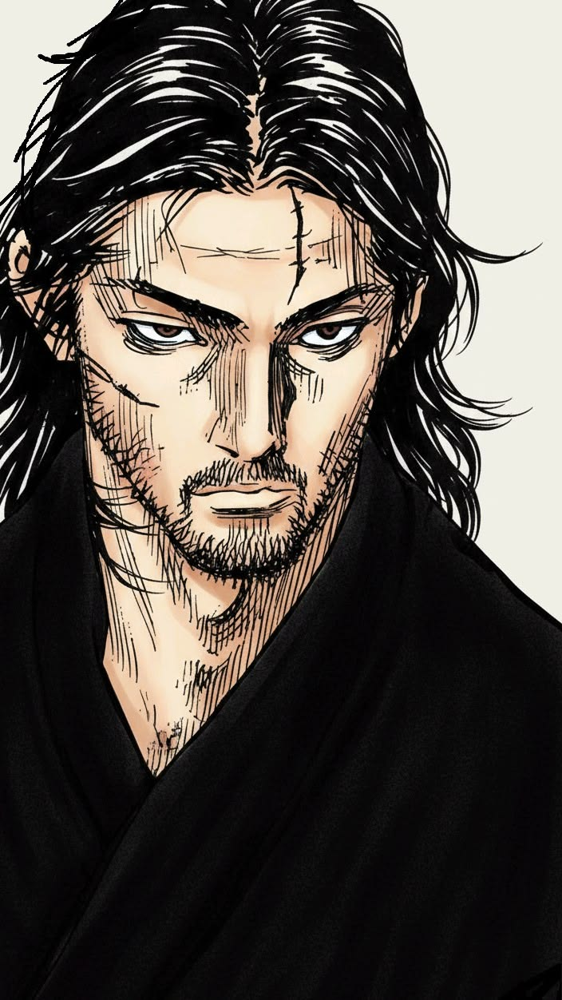
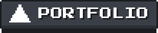
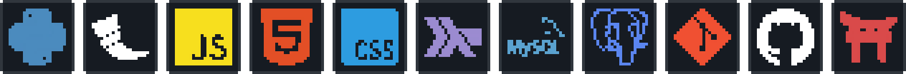

<!-- ================= BANNER ================= -->
<div align="center">


</div>

<br>

<!-- ================= ABOUT ME ================= -->
## 🎯 Sobre mí

<table>
<tr>
<td width="60%" valign="top">

```js
const mario = {
  role: "Estudiante de Ingeniería en Sistemas",
  school: "UTN FRRE",
  location: "Resistencia, Chaco 🇦🇷",

  building: [
    "Proyectos propios Full Stack",
    "Lexer/parser de lenguajes"
  ],

  learning: [
    "Desarrollo web",
    "Ciberseguridad",
    "Algoritmos y estructuras de datos",
    "Compiladores y teoría de lenguajes"
  ],

  tech: {
    languages: ["Python", "JavaScript", "Haskell", "SQL"],
    backend: ["Flask"],
    database: ["MySQL", "PostgreSQL"],
    tools: ["Git"]
  }
};
```

</td>
<td width="40%" align="center" valign="middle">

<!--
  ACÁ VA TU IMAGEN 👇
  Reemplazá la URL de abajo por la de tu imagen (src="...").
  Opciones:
   1) Subí la imagen a este mismo repo (ej: carpeta /assets) y usá: src="assets/mi-imagen.png"
   2) O usá una URL directa de la imagen (que termine en .png / .jpg / .gif)
-->


</td>
</tr>
</table>

Soy estudiante de Ingeniería en Sistemas en la UTN FRR (Resistencia, Chaco) y estoy dando mis primeros pasos en el mundo del desarrollo y la tecnología. Me metí en IT por curiosidad y hoy es lo que más me apasiona: entender cómo funcionan las cosas "por dentro" y construir soluciones que sirvan para algo real.

Estoy en una etapa de aprendizaje activo: probando lenguajes, armando proyectos propios y metiéndome de a poco en desarrollo web y ciberseguridad. No busco saber de todo, sino ir sumando bases sólidas y crecer paso a paso.

<br>

<!-- ================= CONTACTO ================= -->
## 📡 Contacto

<div align="center">

<!-- Las imágenes btn-*.png tienen que estar en la misma carpeta que este README -->
<a href="https://mario-balbuena.vercel.app/"></a>
<a href="https://www.linkedin.com/in/mario-balbuena-yusva"></a>
<a href="https://github.com/Marioobalbuenaa27"></a>

</div>

<br>

<!-- ================= TECH STACK ================= -->
## 🛠️ Con qué vengo trabajando

<!--
  La imagen tech-pixel.png tiene que estar en la misma carpeta que este README.
  Orden: Python, Flask, JavaScript, HTML5, CSS3, Haskell, MySQL, PostgreSQL, Git, GitHub, Jinja
-->
<div align="center">



</div>

<br>

<!-- ================= GITHUB ANALYTICS ================= -->
## 📊 GitHub Analytics

<div align="center">


<br>


<br>


</div>

<br>

<!-- ================= FOOTER ================= -->
<div align="center">

<sub>Gracias por pasar por mi perfil ⭐</sub>

<br><br>


</div>